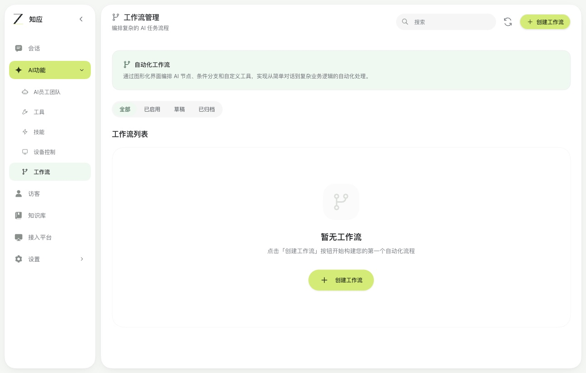
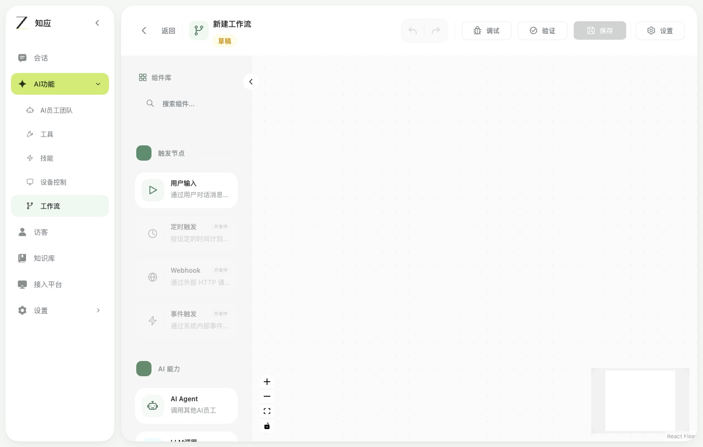
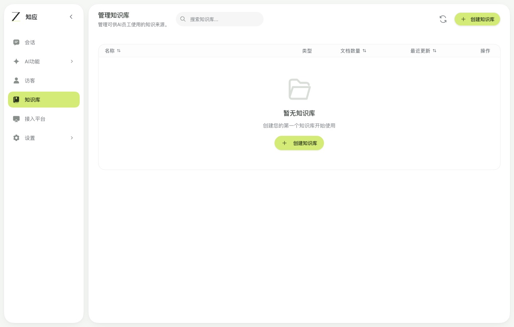

# 知应

知应是一款面向客服团队的 AI 工作台。客服可以在同一个工作台里查看网站访客的消息、维护回答所需的知识库，并在问题需要人工处理时接管会话。

## 产品功能

- **访客会话** · 通过网站客服小部件接收访客消息，查看历史、转接会话和人工回复。
- **知识库与 AI 客服** · 导入资料、配置 AI 员工和模型，让回答可以检索知识库并附上来源。
- **工作流草稿** · 在画布上编排节点与条件分支，保存后继续编辑。

## 产品界面

当前版本用于本地演示。会话接入、人工接管和工作流草稿可体验。工作流的发布与执行尚未实现，真实模型问答仍待验收。

知应的本地原型基于 [TGO](https://github.com/tgoai/tgo) 的前端构建，使用独立的 Node.js 服务和 SQLite 数据库。此仓库提供产品介绍和界面演示。
